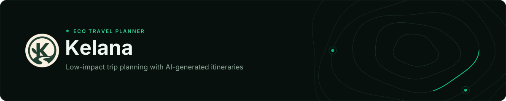

<div align="center">
  
</div>

<div align="center">

[](https://github.com/kelana-ai/kelana/actions/workflows/ci.yml)


[Website](https://kelana-eco.vercel.app) ·
[About](https://kelana-eco.vercel.app/about) ·
[Sign up](https://kelana-eco.vercel.app/signup) ·
[Privacy](https://kelana-eco.vercel.app/privacy)

</div>

Kelana is a travel planner that leans toward low-impact trips. You fill in a
short wizard and it generates a day-by-day itinerary with places, rough costs,
carbon estimates and eco-tags, then shows the plan on a map next to a budget
and carbon cards.

## What it does

- A seven-step wizard collects the trip: destination and dates (search or click
  the map), home location, travel type, travel styles, dietary needs and budget.
- Plans run up to 10 days. Activities show up on the map when the model gives
  them a location.
- "Refine with AI" takes a follow-up request in plain text, and any plan can be
  downloaded as a text file.
- The dashboard summarises upcoming activities, budget allocation and estimated
  carbon savings.
- Itineraries are private to their owner. Sign-in is email and password, every
  table has Row-Level Security, and users can change their profile, upload an
  avatar or delete their account.

## About the numbers

Costs, carbon savings and eco-tags come from the model. They are estimates, not
quotes or audited figures, and the interface labels them that way. Check places
and opening hours before you travel.

## Stack

- [Next.js 16](https://nextjs.org) (App Router, Server Actions, `proxy.ts`) + React 19
- TypeScript (strict)
- Tailwind CSS v4 + [shadcn/ui](https://ui.shadcn.com)
- [Supabase](https://supabase.com) (Postgres, Auth, Storage) with Row-Level Security
- [AI SDK](https://ai-sdk.dev) 7 + OpenAI for generation and refinement
- [Leaflet](https://leafletjs.com) with OpenStreetMap tiles and Nominatim search
- [React Hook Form](https://react-hook-form.com) + [Zod](https://zod.dev) for the wizard
- [Motion](https://motion.dev) for animations
- [Vitest](https://vitest.dev) for unit tests
- [Vercel](https://vercel.com) and GitHub Actions for hosting and CI/CD

## Getting started

Needs Node.js 24. pnpm 10 is pinned in `package.json`.

```bash
pnpm install
cp .env.example .env
pnpm dev
```

Fill in `.env` first (see below) and run the SQL in `supabase/migrations/`
against your Supabase project. The app is then at
[http://localhost:3000](http://localhost:3000).

## Verify

```bash
pnpm lint
pnpm typecheck
pnpm test
pnpm build
```

CI runs the same checks, with a coverage report from `pnpm test:coverage`. `pnpm start` serves the production build.

## How it works

1. The wizard validates the trip with Zod and calls a server action.
2. The action validates it again, checks the rate limit and asks the model for
   a structured itinerary.
3. The result is cleaned up before it's saved: dates come from the request, the
   budget spent is the sum of the activity costs, and times, coordinates and
   enums are validated.
4. Days and activities are written in batches, and the itinerary page reads
   them back with one nested query.

Refining runs the same steps with the user's instruction, and the old days are
replaced only once the new ones are ready.

A few details:

- Dates travel as `yyyy-MM-dd` and are stored exactly as picked, so a trip
  can't shift by a day because of time zones.
- A trip is capped at 10 days. Generation is rate-limited per user, in memory
  for each server instance and with a daily count in the database. Refining
  only has the in-memory limit.
- The model is `OPENAI_MODEL`, which defaults to `gpt-6-luna`.

## Environment variables

Copy `.env.example` to `.env` and fill in:

- `NEXT_PUBLIC_SUPABASE_URL`: Supabase project URL
- `NEXT_PUBLIC_SUPABASE_PUBLISHABLE_KEY`: Supabase publishable key
- `OPENAI_API_KEY`: used to generate and refine itineraries
- `OPENAI_MODEL`: optional, overrides the default model
- `NEXT_PUBLIC_SITE_URL`: public URL of the site, used for the sign-out
  redirect and metadata

Authorization is handled by Row-Level Security, so there's no service-role key.

## Database

Schema and policies are in `supabase/migrations/`. Apply them with
`supabase db push` or run the files in order.

```text
auth.users ──1:1── profiles
itineraries ──1:N── itinerary_days ──1:N── itinerary_activities
```

- Every table has Row-Level Security scoped to its owner, and the anonymous
  role has no table access.
- `delete_my_account()` lets a user delete their own account. `ping()` is a
  no-op that the keep-alive workflow calls.
- In the Supabase Auth settings, turn off "Confirm email". Sign-up logs the
  user in right away, and Supabase's built-in mailer only sends to team
  members. Use a minimum password length of 8 or more. Leaked-password
  protection needs the Pro plan.

## Deployment

Kelana deploys to [Vercel](https://vercel.com) from GitHub Actions with the
Vercel CLI, so production only gets commits that passed CI. The workflows run
on `ubuntu-24.04` and live in `.github/workflows/`:

- `ci.yml`: lint, type-check, tests and a build on every push to `main` and every PR
- `deploy-preview.yml`: a Vercel preview for each PR (skipped for forks), with the URL posted as a comment
- `deploy-production.yml`: deploys the commit that passed CI on `main`
- `supabase-keepalive.yml`: calls `ping()` on both Supabase projects twice a week, because the free plan pauses idle projects

Production uses the `kelana` Supabase project and previews use `kelana-dev`.
Environment variables are set per environment in the Vercel project, and
`vercel pull` passes them to the build. That matters because Next.js inlines the
`NEXT_PUBLIC_*` values into the browser bundle. `vercel.json` puts the functions
in Singapore (`sin1`), next to the database, and the routes that generate or
refine itineraries set `maxDuration = 300`, the most a function can run on the
free plan.

### Dependency notes

- `typescript` is pinned to `~6.0.3` because typescript-eslint doesn't support
  TypeScript 7 yet.
- `@types/node` stays on 24 to match the Node 24 runtime.
- `pnpm.onlyBuiltDependencies` lets only `sharp` run install scripts.
- The workflows install the Vercel CLI with npm at an exact version.

### One-time setup

1. Link the Vercel project with `vercel login` and `vercel link`.
2. Add these secrets to the GitHub repo (Settings → Secrets and variables → Actions):
   - `VERCEL_TOKEN`: a Vercel access token scoped to the team (Account Settings → Tokens)
   - `VERCEL_ORG_ID`: from `.vercel/project.json`
   - `VERCEL_PROJECT_ID`: from `.vercel/project.json`
3. Add the repository variables the keep-alive workflow reads: `SUPABASE_PROD_URL`, `SUPABASE_PROD_KEY`, `SUPABASE_DEV_URL` and `SUPABASE_DEV_KEY` (public URLs and publishable keys).
4. Add the environment variables in the Vercel project settings.

## License

[MIT](LICENSE) © Kelana.
